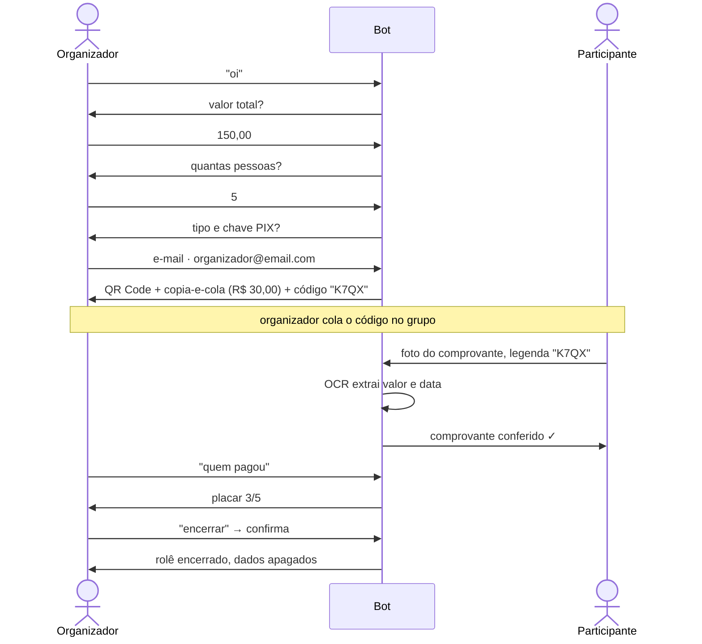

<div align="center">


</div>

<br />

Bot de WhatsApp que organiza a divisão de conta de um rolê em grupo. O organizador informa o valor e quantas pessoas vão rachar, recebe um **PIX copia-e-cola com QR Code** e um **código curto do rolê**. Cada participante manda o comprovante para o bot, que lê o valor com **OCR**, confere com a parte de cada um e monta o placar de quem já pagou.

### `> como funciona`



| Comando (mensagem do organizador) | O que faz |
|---|---|
| qualquer outro texto, sem conversa em andamento | inicia a criação guiada do rolê |
| `pago` · `status` · `quem pagou` | mostra o placar de pagamentos |
| `encerrar` | pede confirmação e apaga o rolê do banco |

### `> decisões de projeto`

- **Não custodia dinheiro.** O bot só gera o payload PIX com a chave do próprio organizador e lê comprovantes. Não há integração com nenhum PSP.
- **OCR é indício, não prova.** O status é "comprovante conferido por OCR", nunca "confirmado pelo banco". Se o valor lido não bate com a parte da pessoa (tolerância de R$ 0,01), fica como `comprovante_enviado` para o organizador conferir. Um reenvio sempre substitui o anterior.
- **Só conversa 1:1 e o bot nunca inicia.** A WhatsApp Cloud API não lê grupos comuns e cobra mensagens iniciadas pela empresa fora da janela de 24h. Por isso o código do rolê é colado no grupo pelo organizador e todo o fluxo é reativo.
- **Encerrar é `DELETE` de verdade.** Só o organizador encerra, com confirmação explícita. Não há soft delete: os dados do rolê deixam de existir.
- **Parsing determinístico.** Valores em formato brasileiro (`150,50`, `150.50`, `150`) são lidos por regras, sem LLM no meio, para o comportamento ser previsível e testável.
- **PIX BR Code implementado à mão**: campos TLV com comprimento em bytes UTF-8 e CRC16-CCITT, gerando o copia-e-cola e a imagem do QR Code.

### `> arquitetura`

```
app/
├── api/webhook.py              GET (verificação da Meta) e POST /webhook
├── core/                       config (pydantic-settings), logging, parsing BRL, exceções
├── db/models.py                Role, Participant, ConversationState (SQLAlchemy 2, tipado)
├── repositories/               acesso a dados por agregado
└── services/
    ├── interfaces.py           Protocols: PixGenerator, OcrExtractor, WhatsAppClient
    ├── conversation_service.py máquina de estados da conversa
    ├── role_service.py         criação, pagamento, placar e encerramento
    ├── pix.py                  BR Code + QR Code
    ├── ocr.py                  Tesseract (por) + extração de valor e data
    └── whatsapp_client.py      cliente httpx da Cloud API
alembic/                        migrations versionadas
tests/                          unitários + integração com Postgres
```

Os services dependem de `Protocol`s, não das implementações concretas. Isso permite testar o fluxo inteiro com fakes, sem WhatsApp, Tesseract ou rede.

**Máquina de estados da conversa:** `aguardando_valor` → `aguardando_num_pessoas` → `aguardando_tipo_chave_pix` → `aguardando_chave_pix` → rolê criado. O encerramento passa por `aguardando_confirmacao_encerramento`.

### `> rodando localmente`

```bash
cp .env.example .env           # preencha as credenciais da WhatsApp Cloud API
docker compose up --build      # Postgres + app (aplica as migrations no start)
```

A API sobe em `http://localhost:8000`. Para receber mensagens reais, exponha a porta (ex: ngrok) e cadastre `https://<url>/webhook` no app da Meta, usando o mesmo `WHATSAPP_VERIFY_TOKEN`.

| Variável | Descrição |
|---|---|
| `DATABASE_URL` | URL do Postgres (o compose já define) |
| `WHATSAPP_TOKEN` | token de acesso da Cloud API |
| `WHATSAPP_PHONE_NUMBER_ID` | ID do número do bot |
| `WHATSAPP_VERIFY_TOKEN` | token de verificação do webhook |

### `> testes`

```bash
pip install -r requirements.txt
pytest
```

São 60 testes: OCR, PIX (payload e CRC), parsing, máquina de estados da conversa, regras do rolê, webhook e cliente do WhatsApp. Há também testes de integração do encerramento com Postgres.

<div align="center">
<br />
<sub>Desenvolvido por <a href="https://github.com/cm0420">Miguel Costa</a></sub>
</div>
